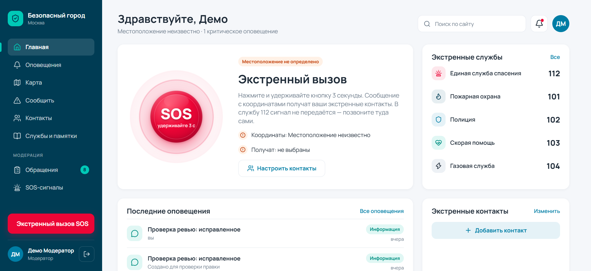
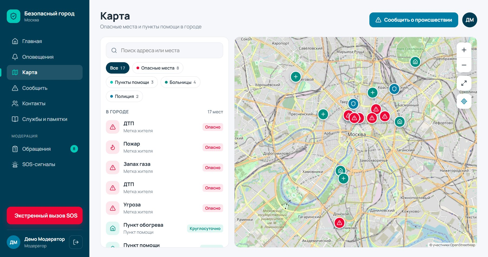
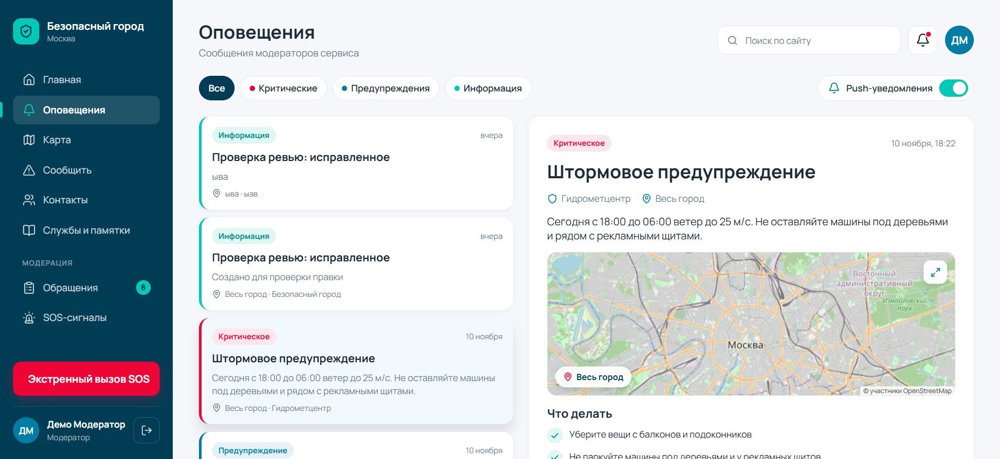
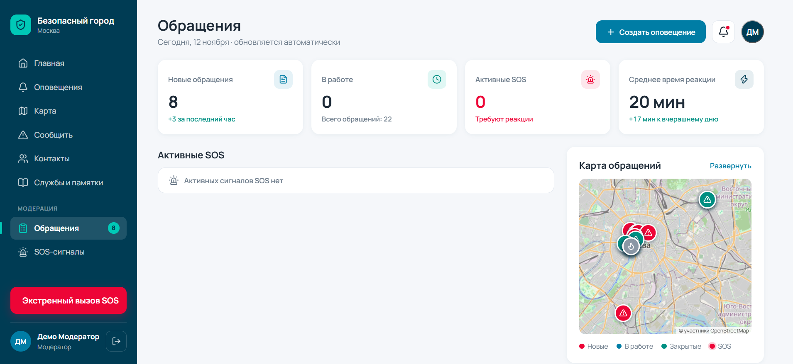
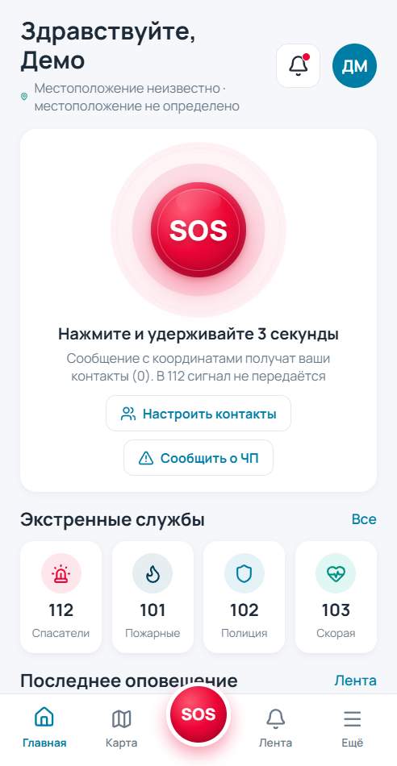
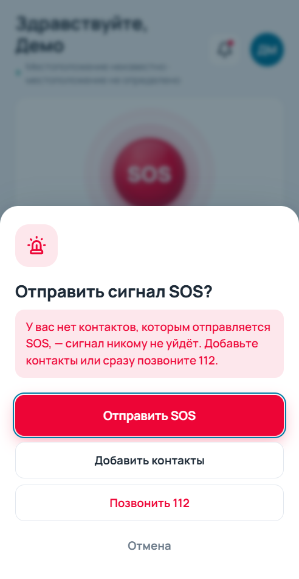

# Безопасный город

Информационная система, в которой жители города сами сообщают друг другу об опасностях,
просят и предлагают помощь: метки на карте, SOS близким, лента оповещений, памятки.
Учебный проект, дисциплина «Управление программными проектами».

| Папка | Что внутри |
|---|---|
| [`backend/`](backend) | API на FastAPI + PostgreSQL |
| [`frontend/`](frontend) | React + Vite (веб и мобильная вёрстка по макетам Figma) |
| [`agents/`](agents) | решения, архитектура, API-контракт, план этапов |

## Скриншоты

Главная с кнопкой SOS (удерживать 3 секунды) и карта города с метками:





Лента оповещений с картой района и панель модератора (обращения, SOS, карта обращений):





Мобильная версия: главная и подтверждение отправки SOS.

<p>
  
  
</p>

## Быстрый старт
```bash
docker compose up -d db
cd backend && cp .env.example .env && uv sync && uv run alembic upgrade head
uv run uvicorn app.main:app --reload      # http://localhost:8000/docs
```
```bash
cd frontend && npm ci && npm run dev      # http://localhost:5173
```

Стиль кода, коммиты и тесты: [agents/07-conventions.md](agents/07-conventions.md).
